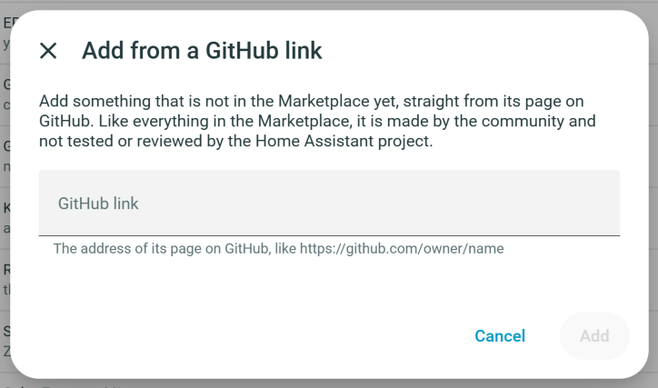
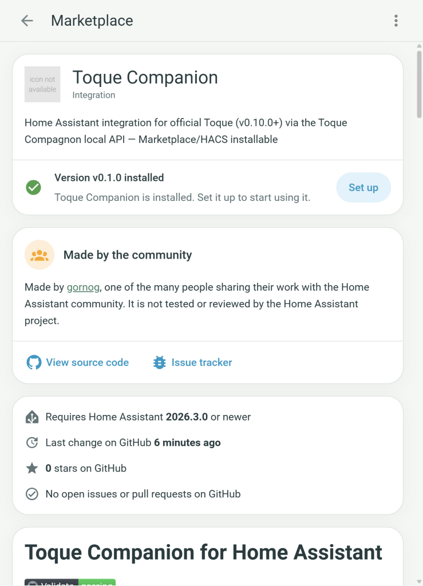
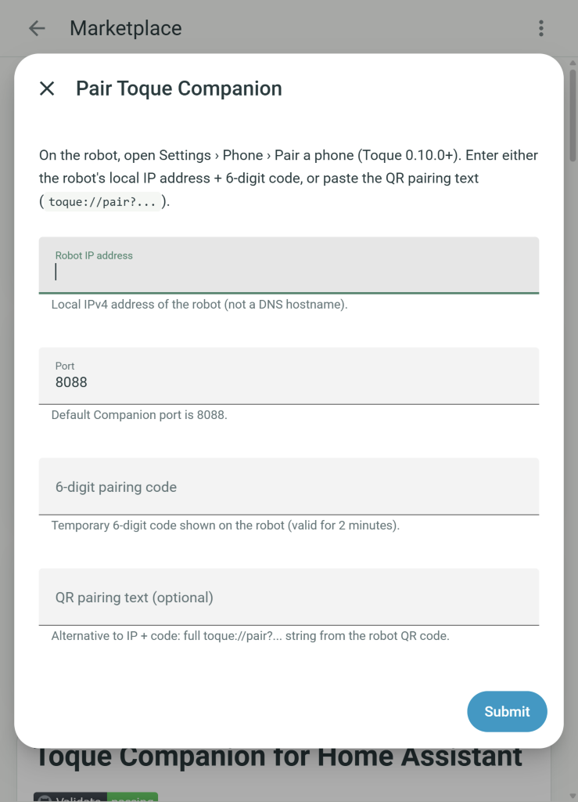
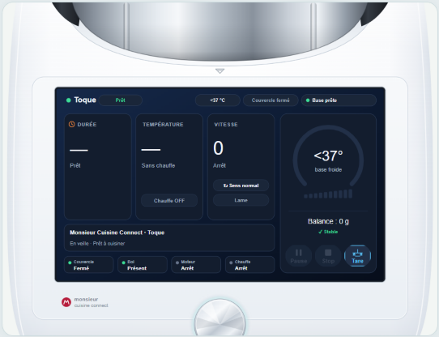

# Toque Companion for Home Assistant

[](https://github.com/gornog/toque-companion-homeassistant/actions/workflows/validate.yml)

Custom Home Assistant integration for **stock official [Toque](https://github.com/Wuki60/MrCuisineVibeConnect) (v0.10.0+)** on the Lidl **Monsieur Cuisine Connect** (`SKMC 1100` / `SKMC 1200`) and **Monsieur Cuisine Smart**, using the official **Toque Compagnon v1** local HTTP API (`port 8088`).

*Français : intégration Home Assistant pour **Toque officiel (v0.10.0+)** utilisant l’API locale officielle **Toque Compagnon v1** (port `8088`). Surveillance complète en temps réel + commandes sûres **Pause**, **Arrêter** et **Tare** uniquement — sans fork firmware, sans broker MQTT.*

---

## Why this integration?

Official Toque **0.10.0** introduced **Toque Compagnon** directly in the stock robot app (`Réglages › Téléphone › Appairer un téléphone`). This integration talks directly to that official API:

- **No custom firmware fork or MQTT broker required** — runs against stock official Toque `0.10.0+`.
- **Real-time local push** via a single bounded long-poll loop (`GET /api/state?since=<rev>&wait=20&replace=1`) + journal alerts (`GET /api/journal`).
- **Cryptographic robot identity proof (`POST /api/prove`)** verified in constant time (HMAC-SHA256) before sending the bearer token initially, after network errors, or when updating the robot IP. If proof fails, the token is never transmitted.
- **Safety-scoped controls**: exposes **Pause**, **Stop**, and **Tare** buttons whose availability strictly tracks the robot's authoritative `state.can.*` flags. Remote **start**, **resume**, **adjust**, **Turbo**, hot-blend confirmation, and recipe writes are intentionally omitted.
- **Full French and English UI** (`fr` / `en`) and **redacted diagnostics**.

---

## Prerequisites

- A Monsieur Cuisine running **official Toque v0.10.0 or newer** (`protocol: 1` verified against tag `v0.10.0`, commit `b2bfe1ceac95bac890912237bbe58ade68a3bfeb`).
- Home Assistant **2026.3.0+** (tested against Home Assistant OS `2026.11.2`).
- Robot and Home Assistant on the **same local network**.

---

## Installation via Home Assistant Marketplace (formerly HACS)

Starting with **Home Assistant 2026.11**, HACS is integrated into Home Assistant Core as **Marketplace** (`Settings › Marketplace`). Older HA versions continue to use **HACS** with the exact same `hacs.json` repository format.

### Option 1 — Home Assistant Marketplace (HA 2026.11+)

1. Open Home Assistant and go to **Settings › Marketplace** (`/marketplace`).
2. Click **Add from link** in the top bar (or **⋮ › Custom repositories › Add from link**).
3. Paste the repository URL into **GitHub link** and click **Add**:
   ```text
   https://github.com/gornog/toque-companion-homeassistant
   ```
   Marketplace automatically detects the repository type as **Integration**.

   

4. Open **Toque Companion**, click **Install**, and confirm **Install**.
   On Home Assistant 2026.11+, the integration installs live (no restart required) and shows a **Set up** button.

   

### Option 2 — Classic HACS (HA 2026.3 – 2026.10)

1. Open **HACS › ⋮ › Custom repositories**.
2. Add `https://github.com/gornog/toque-companion-homeassistant` with category **Integration**.
3. Search for **Toque Companion**, download the latest release, and **restart Home Assistant**.

### Option 3 — Manual installation

Copy `custom_components/toque_companion` into your Home Assistant `config/custom_components/` directory and restart Home Assistant.

---

## Pairing & Configuration

> **Note:** Toque's Companion HTTP server (port `8088`) only listens while the pairing screen is open or at least one client is already paired. A refused connection before pairing is normal.

1. On the robot, open **Réglages › Téléphone › Appairer un téléphone** (*Settings › Phone › Pair a phone*).
   - The robot opens a temporary **6-digit code** (and QR code) valid for **2 minutes** (locked after 5 wrong attempts; up to 8 paired clients).
2. In Home Assistant, click **Set up** from Marketplace (or go to **Settings › Devices & services › Add integration › Toque Companion**).
3. Enter either:
   - The robot's **local IPv4 address**, port (`8088`), and **6-digit pairing code**, **or**
   - The full **QR pairing text** (`toque://pair?v=1&h=...&p=8088&s=...&r=...`).

   

4. Click **Submit**. Home Assistant pairs as its own dedicated client, verifies the robot's HMAC-SHA256 identity proof (`POST /api/prove`), and creates the device.

### Re-pairing & IP changes

- **Removed on the robot (`401`)**: Home Assistant automatically starts a **Reauthentication** flow to pair with a fresh 6-digit code.
- **Robot IP changed (DHCP)**: Use **Reconfigure** on the integration entry to update the IP address. Home Assistant runs `POST /api/prove` before sending the stored token.
- **Deleting the integration**: Performs a best-effort `DELETE /api/phones/me` to free the slot on the robot.

---

## Entities

### Sensors

| Entity | Description | Notes |
|---|---|---|
| **Status** (`status`) | `idle`, `starting`, `running`, `paused`, `stopping`, `finished`, `aborted`, `fault` | Translated in FR & EN |
| **Temperature** (`temperature`) | Bowl temperature (°C) | `unknown` below 37 °C on Connect or when `tempKnown=false` on Smart |
| **Target temperature** (`target_temperature`) | Target temperature (°C) | |
| **Weight** (`weight`) | Scale reading (g) | |
| **Speed level** (`speed_level`) | Active job speed level (`0`–`10`) | `0` when idle |
| **Time remaining** (`remaining_time`) | Remaining program duration (s, displayed in min) | |
| **Estimated end** (`estimated_end`) | End timestamp while `job.counting` is true | Cleared when paused or idle |
| **Program** (`job_label`) | Active or ended program title | Attributes: `kind`, `state`, `phase`, `reverse`, `accessory`, `pause_reason`, `end_reason` |
| **Current recipe** (`recipe`) | Guided recipe title | Attributes: `recipe_id`, `servings`, `step_count`, `waiting_for` |
| **Step** (`step_number`) | Current guided step (`n/N`) | |
| **Current step** (`current_step`) | Step text (truncated to 255 chars; full text in unrecorded `text` attribute) | Includes `machine_summary` and weighing target |
| **Waiting recipe** (`waiting_recipe`) | Recipe waiting on robot home screen | |
| **Last activity** (`last_activity`) | Last finished activity title | Attributes: `kind`, `outcome`, `summary` |
| **Base link** (`link_state`, diagnostic) | `offline`, `arming`, `ready`, `lost` | |
| **Fault message** (`fault_message`, diagnostic) | Active latched fault text | Attribute: `code` |

### Binary sensors

- **Lid open** (`lid_open`), **Bowl present** (`bowl_present`), **Motor** (`motor`), **Heater** (`heater`), **Hot contents** (`hot`, ≥ 60 °C), **Scale stable** (`scale_stable`), **Fault** (`fault`), **Turbo** (`turbo`, disabled by default).

### Safe control buttons

- **Pause** (`pause`) — `POST /api/machine/pause`
- **Stop** (`stop`) — `POST /api/machine/stop`
- **Tare scale** (`tare`) — `POST /api/machine/tare`

Each button's availability tracks the robot's `state.can.<action>.allowed`. Refusals (`409`) and timeouts (`504 timeout` / `504 no_answer`) are surfaced cleanly without automatic retries.

### Events

- **Cooking** (`event.<device>_cooking`) — fed by `/api/journal?after=`: `waiting`, `step_end`, `job_end`, `pause`, `fault`, `temp_reached`. Historical alerts at startup and alerts older than 2 minutes are skipped.

---

## Dashboard example (Lovelace)

A ready-to-use interactive dashboard tile is in [`examples/lovelace-dashboard-tile`](examples/lovelace-dashboard-tile): a vector Monsieur Cuisine Connect frame with a faithful Toque screen driven live by this integration's entities, plus tappable **Pause / Stop / Tare** buttons (English and French YAML, entity-prefix generator, offline validator).



---

## Security Disclosure

- **Plain HTTP on LAN**: Per Toque's upstream Companion v1 design, traffic on port `8088` is plain HTTP without TLS. The HMAC-SHA256 proof exchange (`POST /api/prove`) prevents Home Assistant from sending its bearer token to an imposter or reassigned IP, **but does not encrypt traffic against a passive LAN eavesdropper**. Keep the robot and Home Assistant on a trusted private LAN and never expose port `8088` to the internet.
- **Credential redaction**: `diagnostics.py` redacts tokens, phone IDs, and host addresses.

---

## Development & Testing

All protocol and integration logic can be tested locally without a physical robot:

1. **Unit & fake-server tests** (`tests/test_api.py`, `tests/test_config_flow.py`, `tests/test_integration.py`):
   ```bash
   pip install -r requirements_test.txt
   pytest -m "not simulator"
   ```
2. **Official PC simulator end-to-end tests** (`tests/test_simulator_e2e.py`):
   Runs against Wuki60's real Toque `v0.10.0` JVM Companion simulator (`./gradlew :core:companionDemo -PdemoArgs="--port 18088 --fast 5"`).

---

## Attribution & Related Projects

This project builds on and respects the work of the Toque community:

- **[Wuki60/MrCuisineVibeConnect](https://github.com/Wuki60/MrCuisineVibeConnect)** & **[Wuki60/ToqueCompagnon](https://github.com/Wuki60/ToqueCompagnon)** (MIT) — Authors of Toque, the official Companion v1 HTTP protocol (`docs/COMPANION.md`, PR #97), and the PC simulator.
- **[McSoda/toque-homeassistant](https://github.com/McSoda/toque-homeassistant)** (MIT) — Earlier Home Assistant integration targeting McSoda's fork HTTP/SSE API (`/api/v1`, port `8765`), which inspired the HACS/CI layout and French/English entity design conventions.
- **[oscarsanchezdm — PR #50](https://github.com/Wuki60/MrCuisineVibeConnect/pull/50)** — Upstream read-only MQTT Discovery publisher proposal for Toque.

---

## License

[MIT](LICENSE)
