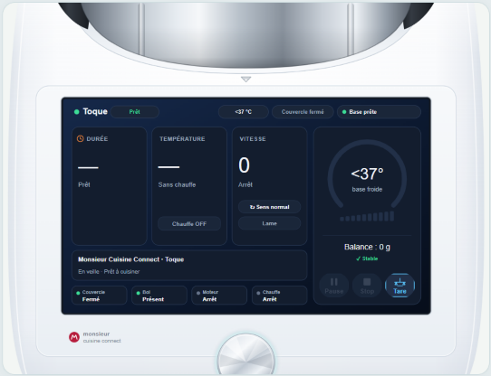

# Toque Companion — Interactive Monsieur Cuisine Connect Dashboard Tile

A ready-to-use, 100% vector Home Assistant Lovelace card for **[Toque Companion](https://github.com/gornog/toque-companion-homeassistant)** and **[Toque](https://github.com/Wuki60/MrCuisineVibeConnect)** on the **Silvercrest Monsieur Cuisine Connect (SKMC 1100 / 1200)**.

> **Example only.** This tile is a community example of how to build an interactive dashboard on top of the `toque_companion` entities. It is not part of the integration itself and needs `custom:button-card` from the Marketplace/HACS. Verified with `tools/validate_card.py`; the card's live look was checked against Toque `0.10.0` on a real robot.



## Highlights

- **Crisp Native Vector Hardware Frame** (`www/toque/monsieur-cuisine-connect-frame.svg`, `1200×920`): Lightweight, Retina-sharp SVG frame with brushed stainless-steel bowl detail, slim white console bezel, and centered brushed-silver rotary dial with glowing halo ring.
- **Faithful Toque v0.10.0 Screen** (`1024×600` SVG): Uses Toque's official `Ui.kt` palette (`#16294A → #0D1A31 → #070E1B`, `#131D2E`, `#FF8A3D`, `#5CC8FF`, `#3DDC97`, `#FFC14D`, `#FF5A5F`), 270° `TempRing` arc with target tick, 10 RPM speed bars, scale weight + stability, context bar (guided recipe/step, program phase, waiting recipe, or last activity), and bottom status pills.
- **All 26 Enabled Entities Integrated**: Live telemetry, binary states, cooking event fallback, and safety-scoped interactive **Pause**, **Stop**, and **Tare** buttons (`button.press`, auto-dimmed when `unavailable`), plus transparent tap zones opening `more-info` for every region.
- **Minimal Dependencies**: Uses Home Assistant's built-in `picture-elements` card plus **`custom:button-card`** (from HACS). No `card-mod` required.
- **EN & FR Ready + Prefix Generator**: Ships with standalone `toque-card.yaml` (English) and `toque-card-fr.yaml` (French), plus `tools/generate_card.py` to regenerate for any Home Assistant entity prefix.

---

## Quick Start (Manual Install)

1. **Install prerequisites**:
   - Install and configure the **`toque_companion`** integration in Home Assistant.
   - Install **`button-card`** (`custom:button-card`) via HACS.
2. **Copy the two SVG assets** from `www/toque/` to `/config/www/toque/` on your Home Assistant server:
   - `/config/www/toque/monsieur-cuisine-connect-frame.svg`
   - `/config/www/toque/touch-target.svg`
3. **Check your entity prefix** in **Developer Tools → States**:
   - Example: if your status sensor is `sensor.monsieur_cuisine_connect_status`, your prefix is `monsieur_cuisine_connect_` (the default in `toque-card.yaml` and `toque-card-fr.yaml`).
   - If Home Assistant included an area name (e.g. `sensor.my_area_monsieur_cuisine_connect_status`), generate a custom YAML in one command:
     ```bash
     python tools/generate_card.py --prefix my_area_monsieur_cuisine_connect_ --lang en --out my-toque-card.yaml
     ```
4. **Add to your dashboard**:
   - Edit your view → **Add card** → **Manual** → paste the contents of `toque-card.yaml` (or `toque-card-fr.yaml` / your generated file).
   - **Recommended layout**: In Home Assistant **Sections** views (`max_columns: 3`), place this card inside a **2-column section** (`column_span: 2`) so the `Pause`, `Stop`, and `Tare` controls stay large and touch-friendly on desktop and wall tablets.
5. **Hard-refresh your browser** (`Ctrl+Shift+R`) if `/local/toque/...` SVGs do not appear immediately.

---

## Package Contents

| Path | Description |
| --- | --- |
| `toque-card.yaml` | Standalone English Lovelace card (`prefix: monsieur_cuisine_connect_`) |
| `toque-card-fr.yaml` | Standalone French Lovelace card (`prefix: monsieur_cuisine_connect_`) |
| `www/toque/monsieur-cuisine-connect-frame.svg` | Native `1200×920` vector hardware frame |
| `www/toque/touch-target.svg` | Transparent `100×100` hit-target SVG for `more-info` regions |
| `tools/generate_card.py` | CLI generator supporting `--prefix`, `--lang (en\|fr)`, and `--asset-base` |
| `tools/validate_card.py` | Offline YAML, SVG XML, and Node.js state/button test suite |
| `AGENTS.md` | Step-by-step installation and customization instructions for AI coding agents |
| `preview/` | Cropped live card screenshot plus sample idle and running SVGs |

---

## Integrated `toque_companion` Entities (26 Enabled)

Replace `<p>` with your device prefix (default `monsieur_cuisine_connect_`):

| Domain | Entities | Screen Location |
| --- | --- | --- |
| `sensor` (15) | `<p>status`, `<p>base_link`, `<p>temperature`, `<p>target_temperature`, `<p>speed_level`, `<p>time_remaining`, `<p>estimated_end`, `<p>weight`, `<p>program`, `<p>current_recipe`, `<p>step`, `<p>current_step`, `<p>waiting_recipe`, `<p>last_activity`, `<p>fault_message` | TopBar, Time/Temp/Speed cards, `TempRing` (`<37°` when cold/unknown), Scale, Context bar, Fault banner |
| `binary_sensor` (7) | `<p>lid_open`, `<p>bowl_present`, `<p>motor`, `<p>heater`, `<p>hot_contents`, `<p>scale_stable`, `<p>fault` | TopBar chips, card active borders, Scale stability, bottom status pills, Fault banner |
| `button` (3) | `<p>pause`, `<p>stop`, `<p>tare_scale` | Bottom-right interactive dock (`button.press` on tap, `more-info` on hold) |
| `event` (1) | `<p>cooking` | Context bar badge fallback when idle |

> **Note**: `binary_sensor.<p>turbo` is disabled by default in `toque_companion` and is intentionally not required by this card.

---

## Offline Validation

Requires Python 3 (`pyyaml`) and Node.js on `PATH`:

```bash
python tools/validate_card.py
```

Checks YAML structure, SVG XML validity, presence of all 26 entities and `button.press` targets, and evaluates the JS/SVG templates across idle, running (`min` & `s` duration units), paused with lid open, guided recipe with XML-special characters, waiting recipe, last activity, and fault states.
